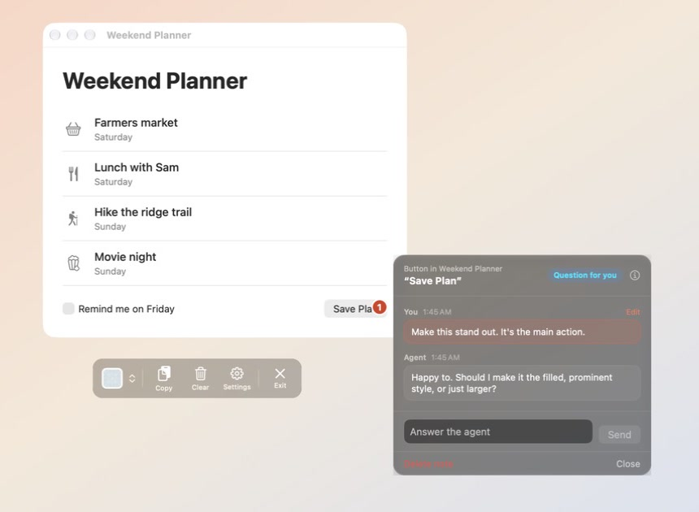

<p align="center">
  
</p>

<h1 align="center">Loupe</h1>

<p align="center"><b>Point at your Mac app. Your agent fixes it.</b></p>

<p align="center">
  <a href="https://britchie4.github.io/Loupe/">Website</a> ·
  <a href="https://github.com/britchie4/Loupe/releases/latest">Download</a> ·
  <a href="#agent-link">Agent Link</a> ·
  <a href="#build-from-source">Build from source</a>
</p>

Loupe is a free Mac app I built for working with coding agents. You point at a button, label or menu in a running Mac app, write what you want changed, and your agent gets a note that says exactly which one you meant. I made it for myself to speed up Mac app development with Claude Code. Hopefully you find it useful too.

<p align="center">
  
</p>
<p align="center"><sub>Loupe on a sample app. The note is pinned to the Save Plan button, and the agent has asked a question on it.</sub></p>

## How it works

1. **Point.** Open Loupe and pick the app you're working on. As you move over it, Loupe highlights whatever is under your pointer and tells you what it is.
2. **Leave a note.** Click the thing you want changed and write the change in your own words. The note gets a numbered badge so you can see where it is.
3. **Hand it off.** Tell your agent "Check my Loupe notes". It reads them, asks you on the note if something isn't clear, makes the change in your code, and turns the badge green.

If you haven't connected an agent, click **Copy** in Loupe's toolbar and paste your notes into whichever coding agent you use.

## Agent Link

Agent Link is new in 2.0. It connects Loupe to your coding agent so you don't have to copy and paste.

It's off until you turn it on in Loupe's **Settings**. Once it's on, your agent can:

- **Read your notes.** It gets what you wrote and which button or label you were pointing at.
- **Ask you when it isn't sure.** The question shows up on the note and you answer it there.
- **Tell you when it's done.** The badge turns green and the note says what it changed.
- **Look at the app you picked.** That's how it checks the change worked.

It can't click or type in your apps. Loupe doesn't give agents a way to do that. The connection is local to your Mac.

### Set it up

The first time you open Loupe, setup offers to connect your agent and lets you practice on a small practice app. You can also do it later:

1. Turn on **Agent Link** in Loupe's Settings.
2. Add Loupe to your agent. Settings has a button for each agent with the exact command for your copy of Loupe. The standard commands are below.
3. Start a new session in your agent. Sessions that were already open won't see Loupe.

**Claude Code** (also covers the Code tab in the Claude desktop app):

```bash
claude mcp add --scope user loupe -- /Applications/Loupe.app/Contents/MacOS/Loupe --mcp
```

**Codex** (also covers the Codex app and editor plugins):

```bash
codex mcp add loupe -- /Applications/Loupe.app/Contents/MacOS/Loupe --mcp
```

**Cursor:** choose Cursor in Loupe's Settings and click **Add to Cursor**, or add Loupe to `~/.cursor/mcp.json`:

```json
{
  "mcpServers": {
    "loupe": {
      "command": "/Applications/Loupe.app/Contents/MacOS/Loupe",
      "args": ["--mcp"]
    }
  }
}
```

**Xcode's built-in agents:** Xcode runs its own Claude Agent and Codex with separate settings, so they need their own lines.

```bash
CLAUDE_CONFIG_DIR="$HOME/Library/Developer/Xcode/CodingAssistant/ClaudeAgentConfig" claude mcp add --scope user loupe -- /Applications/Loupe.app/Contents/MacOS/Loupe --mcp
```

```bash
CODEX_HOME="$HOME/Library/Developer/Xcode/CodingAssistant/codex" codex mcp add loupe -- /Applications/Loupe.app/Contents/MacOS/Loupe --mcp
```

**Claude desktop app (chat):** open **Settings > Developer > Edit Config**, add Loupe under `mcpServers` the same way as the Cursor example, then restart the app.

**Any other agent that supports MCP:** choose **Other agent** in Loupe's Settings and paste the setup prompt into your agent's chat, or register `/Applications/Loupe.app/Contents/MacOS/Loupe --mcp` as a local (stdio) server named `loupe`.

### Teach your agent the routine

The [loupe-notes skill](skills/loupe-notes/SKILL.md) walks an agent through the notes routine: pick up a note, ask when something is unclear, make the change, check it on screen, and report back. Install it for Claude Code, Codex and other agents that read skills:

```bash
npx skills add britchie4/Loupe
```

### What your agent gets

These are the tools Loupe gives a connected agent.

| Tool | What it does |
|---|---|
| `get_status` | Checks that Loupe is running, which app you selected, and how many notes are open. |
| `list_notes` | Lists your notes for the selected app: what you asked for, which control, where it is, and patterns for finding it in code. |
| `get_note` | Gets one note with everything Loupe recorded about its control. |
| `reply_to_note` | Adds a message to a note, usually a question for you. |
| `update_note` | Marks a note seen, done or dismissed, with a message about what changed. |
| `inspect_element` | Reads what is on screen now at a note's location. Read-only. |
| `find_elements` | Searches the selected app's interface for controls by name or kind. Read-only. |
| `edit_practice_app` | Changes the practice app inside Loupe's own setup. It does nothing outside the practice. |

Text that Loupe reads from other apps is passed to the agent as quoted screen data, never as instructions.

## What a copied note looks like

```markdown
## App Feedback: Weekend Planner

### 1. AXButton[title="Save Plan"]
**Location:** AXWindow[title="Weekend Planner"] > AXGroup > AXButton[title="Save Plan"]
**Search patterns:**
- `Text\("Save Plan"\)`
- `Button\("Save Plan"\)`
- `AXButton.*Save Plan`
**Feedback:** Make this stand out. It's the main action.
```

Settings has two choices that affect this:

- **Output Format.** Detailed gives location, search patterns, siblings and disambiguation. Forensic adds every accessibility attribute and frame coordinates.
- **Display Style.** Humanized shows `Button “Save”` in labels and note windows. Technical shows `AXButton[title="Save"]`. Copied output is always technical.

## Install

[Download the latest release](https://github.com/britchie4/Loupe/releases/latest) (.dmg) and drag Loupe to Applications.

The first time you open Loupe, it asks for permission to read other apps. macOS 27 and later call this "Device Control and Data Access", and earlier versions call it "Accessibility". After that, setup offers a short practice. You can reopen it any time from **Practice Using Loupe** in the menu bar icon.

**Requirements:** macOS 14 (Sonoma) or later.

## Updating

If you're on 1.2.1 or later, Loupe updates itself. It asks once whether to check automatically, and you can choose **Check for Updates…** from the menu bar icon or by right-clicking the toolbar.

If you're on an older version, update by hand once:

1. Quit Loupe (right-click the toolbar and choose **Quit Loupe**).
2. [Download the latest release](https://github.com/britchie4/Loupe/releases/latest).
3. Drag Loupe to Applications, replacing the old copy. You won't have to grant the permission again.

## Build from source

```bash
git clone https://github.com/britchie4/Loupe.git
cd Loupe
open Loupe.xcworkspace
```

Open the workspace (not the `.xcodeproj`) and run with Xcode (Cmd+R). From the command line:

```bash
xcodebuild -workspace Loupe.xcworkspace -scheme Loupe -configuration Debug build
```

```bash
xcodebuild -workspace Loupe.xcworkspace -scheme Loupe -configuration Debug test
```

The app shell is in `Loupe/` and the feature code is in `LoupePackage/Sources/LoupeFeature/`. [AGENTS.md](AGENTS.md) has the project layout and working agreements for coding agents.

## Inspired by

[Agentation](https://agentation.dev), which does this for the web. Loupe does it for Mac apps.

## License

MIT. Do what you want with it. See [LICENSE](LICENSE).
